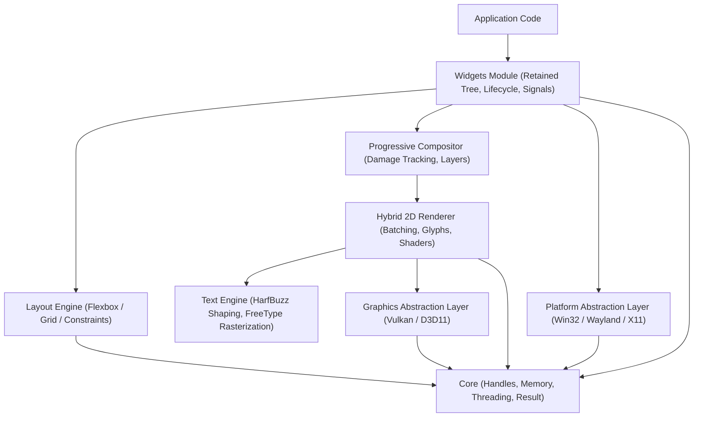

# AGENTS.md — Agent Engineering Guidelines for Northern

## 1. Project Identity and Vision

`northern` is a modular, high-performance, GPU-accelerated desktop UI framework written from scratch in modern C++20. It targets Windows (Win32) and Linux (Wayland and X11), using a custom Graphics Abstraction Layer (GAL) with Vulkan as the primary graphics backend and Direct3D 11 as a secondary Windows backend.

### What Northern Is
- A retained-mode, parent-owned widget framework with a dedicated UI thread, worker thread pool, and asynchronous render thread.
- A custom 2D rendering pipeline utilizing GPU batching, retained display lists, and progressive compositing.
- A platform-independent UI architecture abstracting platform-specific windows, input, clipboard, and accessibility.

### What Northern Is Not
- Not an Electron, Qt, GTK, SDL, or GLFW wrapper. It does not depend on any existing UI framework for its core architecture.
- Not an immediate-mode UI (e.g., Dear ImGui).
- Not a web-engine or HTML/CSS browser shell. Core styling relies on strongly typed design tokens rather than CSS parsing.

---

## 2. Repository and Module Layout

The codebase is organized into discrete, decoupled modules under `src/` where header files (`.hpp`) and implementation files (`.cpp`) are co-located in the same directory per module:

```
northern/
├── cmake/                      # CMake modules, toolchains, compiler setup
├── docs/                       # Architecture documentation, ADRs, specs
├── src/                        # Subsystem modules (.hpp and .cpp co-located)
│   ├── core/                   # Primitives, handles, Result<T, E>, math (.hpp / .cpp)
│   ├── platform/               # Window, events, DPI, clipboard, inputs
│   │   ├── win32/              # Win32 platform implementation (.hpp / .cpp)
│   │   ├── wayland/            # Wayland platform implementation (deferred)
│   │   └── x11/                # X11 platform implementation (deferred)
│   ├── graphics/               # GAL: device, swapchain, buffers, shaders
│   │   ├── vulkan/             # Vulkan GAL backend (.hpp / .cpp)
│   │   └── d3d11/              # Direct3D 11 GAL backend (.hpp / .cpp)
│   ├── renderer/               # 2D batching, paint commands, pipelines (.hpp / .cpp)
│   ├── text/                   # HarfBuzz shaping, FreeType font rasterizer (.hpp / .cpp)
│   ├── layout/                 # Flexbox and Grid layout engines (.hpp / .cpp)
│   ├── widgets/                # Retained widget tree, signals, lifecycle (.hpp / .cpp)
│   ├── richtext/               # Optional rich text editor and document model (.hpp / .cpp)
│   └── devtools/               # Instrumentation, inspection, frame metrics (.hpp / .cpp)
├── tests/                      # Automated test suite (GoogleTest + CTest)
│   ├── unit/                   # Isolated subsystem unit tests
│   └── integration/            # Multi-component and headless rendering tests
├── vcpkg.json                  # Pinned dependency manifest
└── CMakeLists.txt              # Root build definition
```

---

## 3. Architecture Overview



---

## 4. Fundamental Design Contracts

Every contributor and agent must uphold these core architectural invariants:

### 1. Thread Ownership and Concurrency Boundaries
- The **UI thread** exclusively owns the widget tree, state mutations, input dispatch, focus management, and widget lifecycle.
- Cross-thread widget mutation is strictly forbidden.
- Worker threads process immutable snapshots (e.g., text shaping buffers, snapshot-based layout tasks, asset decoding).
- The **Render thread** controls the GAL context, command buffer submission, GPU resource recycling, and swapchain presentation.
- Communication between threads uses lock-free or lightweight thread-safe task queues and atomic scene revision counters.

### 2. GPU Resource Lifetimes and Handle Safety
- Raw GPU pointers must never be stored in widgets or render nodes.
- GPU resources (buffers, textures, pipelines) are referenced via generation-checked, strongly typed handles: `Handle<Texture>`, `Handle<Buffer>`, etc.
- GPU resources must **never** be destroyed immediately while referenced by in-flight command buffers.
- Destruction must pass through a deferred destruction queue, retiring resources only after the associated frame fence/timeline semaphore signals completion.

### 3. Widget Ownership and Lifecycle
- Widget tree ownership follows a strict parent-owned model.
- Each widget has at most one parent. A parent owns the memory of its children.
- Raw pointers to widgets (`Widget*`) are strictly non-owning observers.
- Deletion during event dispatch or callback execution must use deferred deletion (`deleteLater()`).

### 4. Layout vs. Paint Separation
- Visual changes (e.g., color, opacity, hover tint) must invalidate **only** paint state (`markPaintDirty()`), never layout state.
- Layout recalculation (`markLayoutDirty()`) is restricted to mutations affecting geometry, margins, padding, constraints, or child ordering.
- Layout must happen before paint recording; painting records immutable display lists and never mutates widget layout.

### 5. Signals and Slots
- Pure C++20 implementation with no preprocessors, macros, or code generators (no Qt MOC equivalent).
- Must support member-function pointers, lambdas, and receiver-lifetime tracking.
- Safe reentrant emission and safe disconnection during active callbacks are mandatory.
- Emission is synchronous by default; queued cross-thread dispatch must be explicit.

### 6. Error Handling
- Use `northern::core::Result<T, Error>` for recoverable operational and runtime errors.
- Do not use C++23 `std::expected` in public headers.
- Use contracts and debug assertions (`NORTHERN_ASSERT`) solely for programming bugs and invariant violations, never for untrusted input validation or recoverable errors.

### 7. Dependency Encapsulation
- Native OS headers (`<windows.h>`, `<wayland-client.h>`, `<X11/Xlib.h>`) and graphics API headers (`<vulkan/vulkan.h>`, `<d3d11.h>`) must **never** appear in public framework headers.
- Use forward declarations, opaque pointers, or the pImpl pattern to isolate platform and graphics backends.

### 8. Desktop Design System, Anti-Slop, and Optical Geometry
- Authoritative specification defined in [docs/design-languages.md](docs/design-languages.md) and strongly typed in `northern::theme` (`src/widgets/theme.hpp`).
- Strictly forbid generic AI-slop visual tropes: no purple/violet-to-cyan gradients (`#6366F1`, `#8B5CF6`), no glowing neon card borders or colored drop shadows, and no bloated mobile-first padding.
- Surfaces use Optical Zinc neutral elevation ramps (`SurfaceCanvas` `#09090B` through `SurfaceOverlay` `#323238`), framed by crisp 1px hairline borders (`rgba(255, 255, 255, 0.08)` to `0.16`).
- Single deliberate Cobalt accent (`#2563EB`) strictly reserved for primary actions, active fills, and 2px offset focus rings.
- **Optical Vertical Centering**: Text must be centered using `theme::computeCenteredTextY(targetCenterY, font)` (offsetting by cap-height rather than raw `lineHeight`) to avoid text sagging or baseline misalignments.
- **Continuous Vector Geometry**: Vector indicators (such as checkmarks) must be rendered as continuous anti-aliased strokes (`ctx.drawLine`) with rounded end caps, never as disjoint rectangular blocks.

---

## 5. Module Dependency Rules

Circular module dependencies are forbidden. The dependency hierarchy is strictly layered:

1. `Core` has no dependencies on other Northern modules.
2. `Platform` depends only on `Core`.
3. `Graphics` (GAL) depends only on `Core`.
4. `Text` depends on `Core` and external libraries (HarfBuzz, FreeType).
5. `Renderer` depends on `Core`, `Graphics`, and `Text`.
6. `Layout` depends only on `Core`.
7. `Widgets` depends on `Core`, `Platform`, `Layout`, `Renderer`, and `Text`.
8. `RichText` depends on `Widgets`, `Text`, `Renderer`, and `Core`.
9. `DevTools` depends on `Widgets`, `Renderer`, and `Core`.

---

## 6. Coding Conventions and C++20 Standards

- **Standard**: Modern C++20 (`-std=c++20` or `/std:c++20`).
- **Namespace**: Canonical root namespace is `northern::`, partitioned by module (`northern::core`, `northern::graphics`, `northern::widgets`). `nrth` is provided as an official alias.
- **Header Extension**: `.hpp` for all C++ headers; `.cpp` for source files.
- **Header Guards**: `#pragma once` at the top of every header file.
- **Naming**:
  - Types (classes, structs, enums, concepts): `PascalCase` (e.g., `RenderContext`, `WidgetNode`).
  - Functions and methods: `camelCase` (e.g., `markLayoutDirty()`, `submitCommandBuffer()`).
  - Member variables: `camelCase` with trailing underscore (e.g., `parent_`, `cachedSize_`).
  - Constants and enum values: `PascalCase` or `kPascalCase` (e.g., `KeyModifier::Control`, `kDefaultDpi`).
  - Macros: `NORTHERN_UPPER_CASE` (macros should be minimized and avoided where templates/constexpr suffice).
- **Ownership & Pointers**:
  - Use `std::unique_ptr` for exclusive ownership.
  - Non-owning references to alive objects should use references `T&` or raw pointers `T*` where optional/null is valid.
  - Avoid `std::shared_ptr` unless shared ownership is strictly required by the design.

---

## 7. Build System and Tooling

### Prerequisites
- CMake 3.25+
- C++20 compliant compiler: MSYS2 UCRT64 Clang 16+ (`clang++`), GCC 12+, or MSVC 19.30+
- MSYS2 UCRT64 packages (`harfbuzz`, `freetype`, `gtest`, `vulkan-loader`, `ninja`, `cmake`)
- Vulkan SDK 1.3+ (installed on host)

### Standard CMake and Build Commands

```powershell
# Configure with UCRT64 Clang preset
cmake --preset debug

# Build all targets
cmake --build --preset debug

# Run unit tests directly
build\debug\tests\unit_tests.exe

# Verify formatting compliance
clang-format --dry-run --Werror src/widgets/...
```

---

## 8. Approved External Dependencies

Northern isolates external dependencies behind internal wrappers:

| Library                     | Purpose                                                | Public Header Exposure                    |
| --------------------------- | ------------------------------------------------------ | ----------------------------------------- |
| **HarfBuzz**                | Unicode text shaping and OpenType features             | Strictly private (`src/text/`)            |
| **FreeType**                | Font loading, glyph metrics, and outline rasterization | Strictly private (`src/text/`)            |
| **GoogleTest**              | Unit and integration test framework                    | Test code only (`tests/`)                 |
| **Vulkan Headers / Loader** | Vulkan GAL backend                                     | Strictly private (`src/graphics/vulkan/`) |

Any proposal to add a new external dependency must justify correctness, licensing, binary size impact, and maintenance overhead before adoption.

---

## 9. Testing Policy

- **Test-Driven Discipline**: When implementing features or fixing bugs, write an automated failing test in `tests/unit/` or `tests/integration/` before writing production code.
- **Coverage Priorities**:
  - Widget ownership, parent destruction cascades, and reparenting safety.
  - Signal emission during callback disconnection and recursive emission.
  - Generation-checked handle recycling and stale-handle rejection.
  - Layout calculations across min/max constraints, flex wrapping, and nested containers.
  - Damage tracking and dirty-region clipping logic.
- **Headless Testing**: Platform and graphics layers must support headless or mock contexts so unit tests can run in headless CI environments without requiring a physical GPU display.

---

## 10. Agent Working Rules and Prohibitions

1. **Never introduce Qt, GTK, Electron, SDL, or GLFW** dependencies into the core framework.
2. **Never expose native platform or GPU API headers** in public framework headers.
3. **Never modify widget state across threads**; dispatch all UI mutations to the main UI thread.
4. **Never destroy GPU resources immediately** without consulting the in-flight frame fence.
5. **Never trigger layout recalculations for purely visual property updates**.
6. **Never introduce circular module includes** or bypass the module dependency hierarchy.
7. **Never perform git commits or stage files** without explicit user confirmation.
8. **Never introduce AI-slop visual tropes** (`#6366F1`, `#818CF8`, glowing borders, colored drop shadows, or unmotivated gradients); adhere strictly to [docs/design-languages.md](docs/design-languages.md) and `northern::theme`.
9. **Never accumulate legacy test UI or clutter** in demo examples; keep example window titles clean (e.g., strictly `"Windowing"`) and center current implementations.
10. **Never use disjoint pixel blocks** for vector strokes or checkmarks; use `PaintContext::drawLine`.
