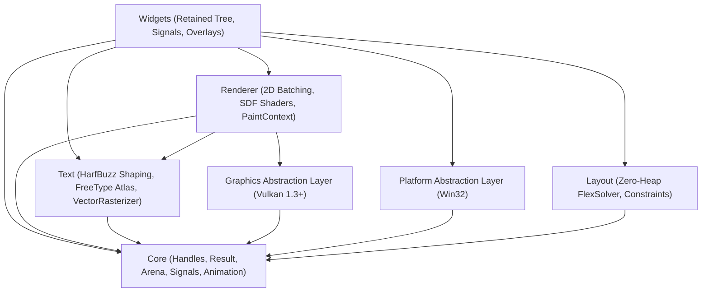

# Northern


A modular, GPU-accelerated desktop UI framework written from scratch in modern C++20 for native desktop applications.
Built around a retained, parent-owned widget tree, custom 2D SDF batch rendering, and a layered Graphics Abstraction Layer targeting Vulkan 1.3+.

---

## Why Northern?

- **Retained Parent-Owned Tree**: Widgets are owned via `std::unique_ptr` hierarchies with generation-checked GPU handles, deferred `deleteLater()`, retained display lists, and strict layout-vs-paint invalidation separation.
- **GPU-Accelerated 2D Pipeline**: Custom `BatchRenderer` coalesces signed-distance-field (SDF) primitives, rounded hairline borders, and glyph atlas quads into minimal draw calls with Vulkan block suballocation and timeline-synchronized staging.
- **Native Typography & Vector Rasterization**: Full Unicode text shaping with HarfBuzz, FreeType glyph rasterization, and analytical vector shape rasterization (`VectorRasterizer`) behind a private text subsystem.
- **Zero-Macro C++20 Signals & Motion**: Type-safe `Signal<Args...>` with `Trackable` lifetime guards alongside an analytical damped-harmonic spring and easing engine.
- **Desktop-First Ergonomics**: DPI-aware scaling (`setDpiScale`), native `Tab`/`Shift+Tab` focus-visible rings, cursor shape dispatch (`IBeam`, `PointingHand`, `ResizeEW`, `ResizeNS`), 500ms delayed tooltips, and top-level overlay popups (`Dropdown`, `ContextMenu`, `MenuBar`).
- **Multi-Panel Containers**: Top-level `MenuBar` with cascading submenus and keyboard accelerators, live resizable `SplitView`, `TabBar`/`TabView` (`Underline`, `Pill`, `EditorCard` styles, SVG icons, drag-to-reorder), and animated `CollapsibleSection`/`Accordion`.
- **Virtualized Collection Views**: $O(1)$ visible slice `ListView`, 2D grid `TableView` with draggable resizable column `HeaderView`, and hierarchical `TreeView` with rotating vector chevrons, role-based `ItemModel`, `ItemSelectionModel`, and `ItemDelegate` badge pills.
- **Frameless Window Shell & OS Integration**: Custom DWM `TitleBar` with Windows 11 Snap Layouts integration (`HTMAXBUTTON`), resolution-independent SVG vector icons (`NanoSVG`), native OS `FileDialog`, multi-monitor `Display` queries, and OS dark/light theme synchronization.

> [!NOTE]
> Windows (`Win32`) and `Vulkan 1.3+` are actively implemented and tested. `Direct3D 11`, `Wayland`, and `X11` backends are planned in the module layout and currently deferred.

---

## Quickstart

### Build & Verify

```powershell
git clone https://github.com/islahulkafa/northern.git
cd northern

cmake -S . -B build -G Ninja -DCMAKE_CXX_COMPILER=clang++
cmake --build build

# Run the headless unit test suite
.\build\tests\unit_tests.exe
```

Expected output:

```text
[==========] Running 324 tests from 54 test suites.
...
[  PASSED  ] 324 tests.
```

Launch the interactive desktop workstation demo:

```powershell
.\build\examples\example_windowing.exe
```

### Minimal C++20 Example

```cpp
#include "widgets/base/widget_context.hpp"
#include "widgets/containers/container.hpp"
#include "widgets/containers/dropdown.hpp"
#include "widgets/controls/button.hpp"
#include "widgets/controls/label.hpp"

using namespace northern::widgets;

void buildUi(WidgetContext& uiContext, std::shared_ptr<northern::text::Font> font) {
    auto root = std::make_unique<Container>();
    root->style().flexDirection = layout::FlexDirection::Column;
    root->style().rowGap = 12.0f;

    root->addChild(std::make_unique<Label>("Workstation", font));

    auto* backendSelect = root->addChild(std::make_unique<Dropdown>(
        std::vector<std::string>{"Vulkan GAL", "Direct3D 11"}, 0, font));
    backendSelect->setTooltip("Select graphics backend");

    auto* applyBtn = root->addChild(
        std::make_unique<Button>("Apply", font, ButtonVariant::Primary));
    applyBtn->setTooltip("Apply changes", "Ctrl+Enter");
    applyBtn->onClicked.connect([backendSelect]() {
        // React to button click using backendSelect->selectedText()
    });

    uiContext.setRootWidget(std::move(root));
}
```

---

## Architecture

Northern enforces a strict acyclic module hierarchy. Platform headers (`<windows.h>`) and graphics API headers (`<vulkan/vulkan.h>`) are isolated behind pImpl boundaries and never leak into public framework headers.



### Architectural Comparison

| Attribute | Northern | Immediate-Mode UI | Web / Electron Shells | Legacy Retained Toolkits |
| :--- | :--- | :--- | :--- | :--- |
| **Rendering Model** | Retained tree + GPU SDF batching | Per-frame full rebuild | DOM + Chromium compositor | CPU / mixed native widgets |
| **Language & ABI** | Pure C++20, `#pragma once`, no macros | C / C++ | JS / TS + V8 IPC | C++ with MOC / codegen |
| **Error Handling** | `Result<T, Error>` monadic types | Assertions / return codes | Exceptions / Promises | Exceptions / global state |
| **Styling System** | Strongly typed Optical Zinc & Cobalt tokens | Manual style push/pop | CSS cascade | QSS / XML stylesheets |
| **External Runtime** | Native binary (`harfbuzz`, `freetype`, `vulkan`) | Minimal | Bundled browser runtime | Large shared runtime |

---

## Documentation

| Guide | Topic |
| :--- | :--- |
| [Getting Started](docs/getting-started.md) | Toolchain prerequisites, CMake + Ninja build, test verification, and demo launch |
| [Architecture Overview](docs/architecture.md) | Module dependency graph, repository layout, pImpl encapsulation, and frame lifecycle |
| [Widgets & UI Systems](docs/widgets.md) | Retained widget catalog, `MenuBar`, `TabView`, virtualized collection views, focus traversal, and animations |
| [Desktop Design Language](docs/design-languages.md) | Optical Zinc surface ramp, Cobalt accent rules, 4px density grid, and focus/motion specs |
| [Agent & Engineering Guidelines](AGENTS.md) | Thread ownership boundaries, GPU handle lifetime rules, and coding conventions |
