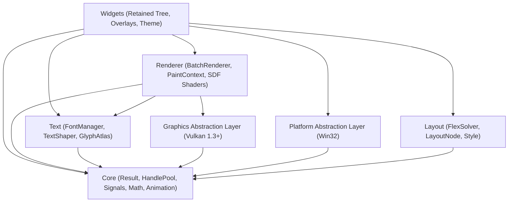
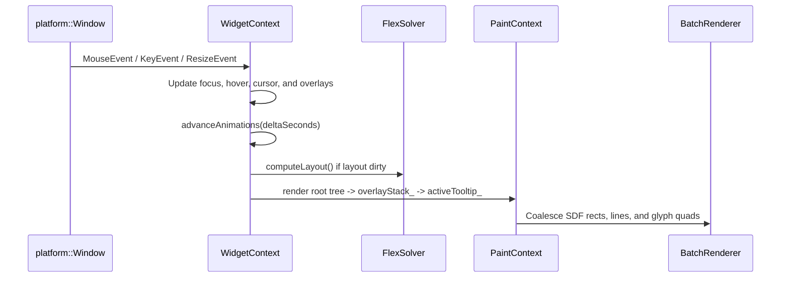

# Architecture overview

This document explains Northern's layered module dependencies, ownership boundaries, layout-to-paint pipeline, and native API encapsulation strategy.

## Module dependency hierarchy

Northern is partitioned into static C++20 libraries in [src/CMakeLists.txt](../src/CMakeLists.txt) with a strict acyclic dependency graph. Lower layers never include or depend on higher layers.



<details>
<summary><strong>Repository directory layout</strong></summary>

```text
northern/
├── cmake/              # Compiler warning profiles and dependency resolution
├── docs/               # Architecture, getting-started, widget, and design specs
├── examples/           # Interactive windowing and controls demo
├── shaders/            # GLSL / SPIR-V 2D SDF shaders
├── src/
│   ├── core/           # Result<T, E>, HandlePool, Signals, Math, Animation
│   ├── platform/       # Window, Clipboard, Events, Win32 backend
│   ├── graphics/       # GAL interfaces and Vulkan 1.3 backend
│   ├── renderer/       # BatchRenderer, PaintContext, DynamicRingBuffer
│   ├── text/           # FontManager, TextShaper, TextLayout, GlyphAtlas
│   ├── layout/         # Style, LayoutNode, FlexSolver
│   └── widgets/        # Retained widget tree, Overlay system, Theme tokens
├── tests/              # GoogleTest unit suite (109 tests)
├── CMakeLists.txt      # Root CMake 3.25+ build definition
└── vcpkg.json          # Dependency manifest (harfbuzz, freetype, gtest)
```

</details>

## Platform and GPU encapsulation

Public headers never expose native OS headers (`<windows.h>`) or graphics backend headers (`<vulkan/vulkan.h>`). Platform and graphics backends isolate third-party types behind pImpl pointers and opaque handle wrappers:

- **Platform isolation**: [Window](../src/platform/window.hpp) delegates to `Window::Impl` in [win32_window.cpp](../src/platform/win32/win32_window.cpp). Cursor updates cross from `WidgetContext::onCursorShapeChanged` to `Window::setCursorShape` via signal binding so widget code remains headless-testable.
- **GPU handle safety**: Rendering primitives reference GPU objects through generation-checked `Handle<Tag>` values managed by [handle_pool.hpp](../src/core/memory/handle_pool.hpp) and [gpu_handle.hpp](../src/graphics/gpu_handle.hpp) rather than raw pointers.
- **Typed error propagation**: Recoverable runtime failures return `northern::core::Result<T, Error>` defined in [result.hpp](../src/core/error/result.hpp).

## Ownership and lifecycle contracts

- **Parent-owned widget tree**: Every [Widget](../src/widgets/widget.hpp) is owned exclusively by its parent via `std::unique_ptr<Widget>`. Raw `Widget*` references (such as `hoveredWidget_`, `focusedWidget_`, and `owner`) are non-owning observers cleared automatically in `WidgetContext::unregisterWidget`.
- **Deferred deletion**: Removing or destroying a widget during an active event callback calls `Widget::deleteLater()`, deferring actual teardown to `WidgetContext::flushDeletedWidgets()` at a safe point in the frame.
- **Thread ownership**: The UI thread owns the entire widget tree, layout pass, input dispatch, and animation state.

## Frame and event lifecycle

Each frame follows a strict sequence from platform input through layout resolution and GPU command recording:



## Layout and paint separation

Geometry mutations (`markLayoutDirty()`) trigger Flexbox recalculation via `LayoutNode::computeLayout`, whereas purely visual state changes (hover tint, focus ring, animation tick, caret blink) call `markPaintDirty()` without re-running layout.
