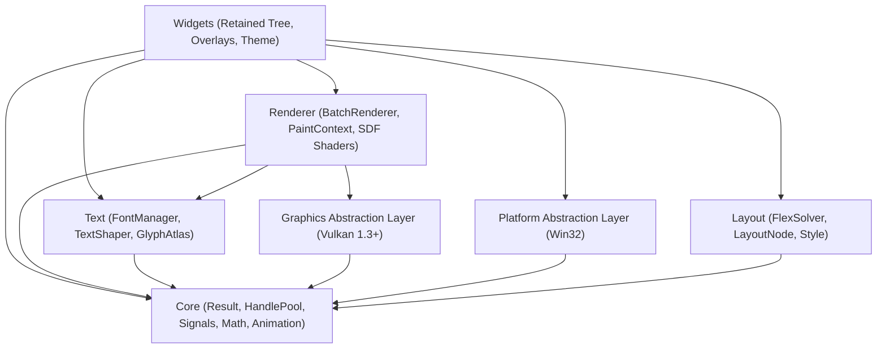
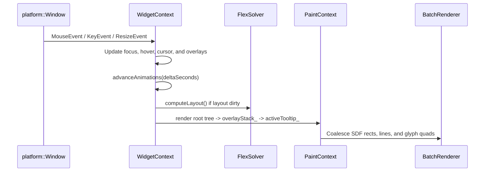

# Architecture overview

This document explains Northern's layered module dependencies, ownership boundaries, layout-to-paint pipeline, and native API encapsulation strategy.

## Module dependency hierarchy

Northern is partitioned into static C++20 libraries in [src/CMakeLists.txt](../src/CMakeLists.txt) with a strict acyclic dependency graph. Lower layers never include or depend on higher layers.



<details>
<summary><strong>Repository directory layout</strong></summary>

```text
northern/
├── cmake/              # Compiler warning profiles and dependency resolution
├── docs/               # Architecture, getting-started, widget, and design specs
├── examples/           # Interactive windowing and controls demo
├── shaders/            # GLSL / SPIR-V 2D SDF shaders
├── src/
│   ├── core/           # Concurrency (ThreadPool, TaskQueue), Arena, Logging, Math, Signals
│   ├── platform/       # Window, Clipboard, Events, Win32 backend
│   ├── graphics/       # GAL (Device, CommandBuffer), Vulkan 1.3 (BlockAllocator, StagingPool), MockDevice
│   ├── renderer/       # BatchRenderer, PaintContext, DynamicRingBuffer
│   ├── text/           # FontManager, TextShaper, TextLayout, GlyphAtlas
│   ├── layout/         # Style, LayoutNode, FlexSolver
│   └── widgets/        # Retained widget tree, Overlay system, Theme tokens
├── tests/              # GoogleTest unit suite (186 tests across 44 suites)
├── CMakeLists.txt      # Root CMake 3.25+ build definition
└── vcpkg.json          # Dependency manifest (harfbuzz, freetype, gtest)
```

</details>

## Platform and GPU encapsulation

Public headers never expose native OS headers (`<windows.h>`) or graphics backend headers (`<vulkan/vulkan.h>`). Platform and graphics backends isolate third-party types behind pImpl pointers and opaque handle wrappers:

- **Platform isolation**: [Window](../src/platform/window.hpp) delegates to `Window::Impl` in [win32_window.cpp](../src/platform/win32/win32_window.cpp). Cursor updates cross from `WidgetContext::onCursorShapeChanged` to `Window::setCursorShape` via signal binding so widget code remains headless-testable.
- **Multi-monitor and desktop integration**: [Display](../src/platform/display.hpp) enumerates physical monitors, work areas, and DPI scales. [Window](../src/platform/window.hpp) provides screen positioning, centering, borderless fullscreen with placement caching, native file drag-and-drop (`onFileDrop`), and OS dark/light theme synchronization (`DWMWA_USE_IMMERSIVE_DARK_MODE`, `Application::isDarkMode()`, `onThemeChanged`).
- **GPU handle safety**: Rendering primitives reference GPU objects through generation-checked `Handle<Tag>` values managed by [handle_pool.hpp](../src/core/memory/handle_pool.hpp) and [gpu_handle.hpp](../src/graphics/gpu_handle.hpp) rather than raw pointers.
- **Typed error propagation**: Recoverable runtime failures return `northern::core::Result<T, Error>` defined in [result.hpp](../src/core/error/result.hpp).

## Ownership and lifecycle contracts

- **Parent-owned widget tree**: Every [Widget](../src/widgets/base/widget.hpp) is owned exclusively by its parent via `std::unique_ptr<Widget>`. Raw `Widget*` references (such as `hoveredWidget_`, `focusedWidget_`, and `owner`) are non-owning observers cleared automatically in `WidgetContext::unregisterWidget`.
- **Deferred deletion**: Removing or destroying a widget during an active event callback calls `Widget::deleteLater()`, deferring actual teardown to `WidgetContext::flushDeletedWidgets()` at a safe point in the frame.
- **Thread ownership**: The UI thread owns the entire widget tree, layout pass, input dispatch, and animation state.

## Frame and event lifecycle

Each frame follows a strict sequence from platform input through layout resolution and GPU command recording:



## Layout and paint separation

Geometry mutations (`markLayoutDirty()`) trigger Flexbox recalculation via `LayoutNode::computeLayout`, whereas purely visual state changes (hover tint, focus ring, animation tick, caret blink) call `markPaintDirty()` without re-running layout.

### High-performance layout engine
Northern's layout subsystem (`northern::layout`) incorporates several high-performance architectural patterns:
- **Zero-heap scratch arena**: `FlexSolver` allocates temporary `FlexItem`, `FlexLine`, and out-of-flow child lists using `core::ArenaAllocator<T>` backed by a thread-local `core::Arena`. A `core::ScopedArena` rolls back arena offsets on solver exit in $O(1)$, eliminating dynamic heap allocations (`new`/`delete`/`malloc`/`free`) during layout passes.
- **Dual-level layout and measurement caching**:
  - `LayoutNode::computeLayout` caches the last solved available width/height; if unchanged and `!isDirty()`, recursive subtree solving is bypassed immediately.
  - Leaf nodes maintain a fixed-capacity MRU measurement cache for intrinsic callbacks (e.g. text shaping in `Label`), reducing redundant shaping runs during iterative flex line wrap and cross-axis resolution.
  - Subtree dirty flags (`markDirty()`) propagate up parent chains and invalidate layout/measure caches safely.
- **W3C-compliant aspect ratio**: `Style::aspectRatio` (`std::optional<float>`) allows widgets to preserve geometric proportions ($W / H$). The solver dynamically resolves auto dimensions from definite opposite axes during flex basis, flex line sizing, and cross-axis alignment while enforcing min/max boundaries.

## Retained display lists and viewport culling

`WidgetContext::render()` maintains a retained `PaintContext` cache:
- When scenes have no dirty layout nodes, no paint-dirty widgets, and no active animations, previously recorded paint commands are reused directly via `PaintContext::append()`, bypassing recursive widget tree traversal.
- Subtree rendering implements viewport scissor culling against `visibleBounds`, skipping `paint()` recording for widgets situated entirely outside the current viewport.

## Memory and arena management

Frame-scoped temporary structures, layout calculation slices, and text shaping buffers utilize `northern::core::Arena` and `northern::core::ScopedArena`:
- **Chunked bump allocator**: Allocates contiguous memory blocks without invoking OS page allocations between frames.
- **RAII rollback**: `ScopedArena` captures a checkpoint marker and rolls back arena offsets on scope exit.
- **STL compatibility**: `northern::core::ArenaAllocator<T>` allows standard containers (`std::vector<T, ArenaAllocator<T>>`) to allocate directly out of an `Arena`.

## Concurrency and task scheduling

- **Worker ThreadPool**: Background tasks (font shaping, asset loading, heavy computations) execute on `northern::core::ThreadPool` using `std::jthread` and returning standard `std::future<T>`.
- **UI TaskQueue**: Thread-safe MPSC double-buffered task queue allows background threads to dispatch callbacks to the main UI thread without lock contention.
- **Idle Power Throttling**: When static, the main loop calls `Application::waitEvents(timeoutMs)` implemented via `MsgWaitForMultipleObjectsEx`, dropping idle CPU usage to near 0%.

## GPU suballocation and non-blocking staging

Northern's Vulkan GAL optimizes GPU memory and transfer throughput:
- **Block suballocation**: `VulkanMemoryAllocator` allocates 64MB device-local and 16MB host-visible memory blocks, suballocating buffer and image allocations with free-list coalescing to minimize driver syscall overhead.
- **Timeline-synchronized staging**: `VulkanStagingPool` provisions reusable host-visible staging slices for texture updates, synchronizing completion with `timelineSemaphore_` to eliminate `vkQueueWaitIdle` stalls.
- **Warm pipeline cache**: `VkPipelineCache` persists compiled pipeline blobs to `build/pipeline_cache.bin`, preventing compilation stutter on subsequent runs.
- **Headless mock GAL**: `northern::graphics::MockDevice` provides pure-CPU mock implementations of `Device`, `CommandBuffer`, and `Swapchain`, enabling 100% headless CI test coverage without physical GPUs or Vulkan drivers.
