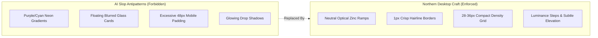
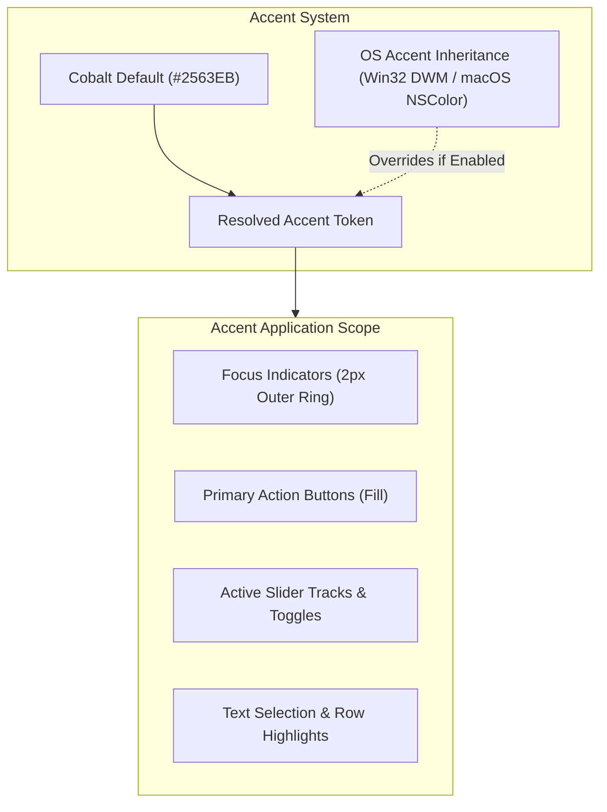
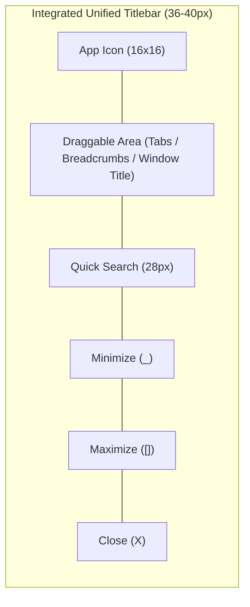

# Desktop Design Language and UX Architecture

This document establishes the official design language, layout metrics, color tokens, and desktop UX specifications for the Northern framework. It defines how Northern applications achieve authentic desktop software craft while strictly eliminating AI slop, unmotivated decoration, and web-centric layout antipatterns.

---

## 1. Core Philosophy and Anti-Slop Invariants

Desktop software operates under fundamentally different constraints than mobile applications and marketing web pages. Desktop users interact via mouse and keyboard for hours at a time, requiring high information density, quiet window chrome, instantaneous responsiveness, and predictable ergonomics.

### The Four Anti-Slop Invariants

1. **Quiet Chrome, Content Foreground**: Window chrome, sidebars, panels, and toolbars must remain strictly neutral. Richness and saturated color belong exclusively to user content (code, documents, artwork, audio waveforms, data visualizations) and purposeful primary actions.
2. **Zero Unmotivated Neon and Gradients**: Strictly forbid violet-to-cyan gradients (`#6366F1` to `#8B5CF6`), neon card borders, glowing drop shadows, and glassmorphic blur filters. Depth is established through subtle luminance steps across surfaces and crisp 1px neutral hairline borders.
3. **High Density over Empty Air**: Forbid excessive mobile-style whitespace. Control heights adhere to a strict 28–36px desktop baseline with compact 8–16px container paddings. Every pixel on screen must serve information hierarchy or functional grouping.
4. **Desktop-Native Ergonomics**: Keyboard navigation, distinct focus rings, instant hover feedback, and native cursor states are first-class requirements—not progressive enhancements.



---

## 2. Desktop Surface Hierarchy and Elevation

Northern establishes depth through a 4-tier surface elevation ramp in neutral optical zinc grays. Surfaces never cast saturated or colored shadows. In dark mode, higher elevation layers become subtly lighter to reflect virtual overhead lighting, framed by 1px hairline borders with fine-tuned opacity.

### Dark Mode Surface Ramp

| Elevation Tier  | Token Name       | Hex Value | Hairline Border             | Usage Context                                               |
| :-------------- | :--------------- | :-------- | :-------------------------- | :---------------------------------------------------------- |
| **0 - Canvas**  | `SurfaceCanvas`  | `#09090B` | None                        | Window backdrop, empty workspace background                 |
| **1 - Base**    | `SurfaceBase`    | `#121215` | None                        | Primary application window body, main content panels        |
| **2 - Surface** | `SurfaceDefault` | `#18181B` | `rgba(255, 255, 255, 0.08)` | Sidebars, toolbars, property inspectors, cards              |
| **3 - Raised**  | `SurfaceRaised`  | `#27272A` | `rgba(255, 255, 255, 0.12)` | Push buttons, input fields, dropdown triggers, active items |
| **4 - Overlay** | `SurfaceOverlay` | `#323238` | `rgba(255, 255, 255, 0.16)` | Menus, popovers, context flyouts, modal dialogs, tooltips   |

### Light Mode Surface Ramp

| Elevation Tier  | Token Name       | Hex Value | Hairline Border       | Usage Context                             |
| :-------------- | :--------------- | :-------- | :-------------------- | :---------------------------------------- |
| **0 - Canvas**  | `SurfaceCanvas`  | `#F4F4F5` | None                  | Desktop workspace backdrop                |
| **1 - Base**    | `SurfaceBase`    | `#FAFAFA` | None                  | Application window body                   |
| **2 - Surface** | `SurfaceDefault` | `#FFFFFF` | `rgba(0, 0, 0, 0.08)` | Sidebars, toolbars, content cards         |
| **3 - Raised**  | `SurfaceRaised`  | `#F4F4F5` | `rgba(0, 0, 0, 0.12)` | Push buttons, input fields, control wells |
| **4 - Overlay** | `SurfaceOverlay` | `#FFFFFF` | `rgba(0, 0, 0, 0.14)` | Menus, context flyouts, dialogs, tooltips |

> [!NOTE]
> Hairline borders are always 1 physical pixel wide (scaled by display DPI: `std::round(1.0f * dpi)`). Borders are blended over surface backgrounds using alpha transparency to adapt seamlessly across elevation transitions.

---

## 3. Color Roles and Palette Architecture

Northern uses a single primary accent color paired with functional semantic tokens. Color is reserved for state communication, actionable triggers, and data alerts.



### Accent Color Tokens

- **Default Cobalt Accent**: `#2563EB` (RGB: `37, 99, 235`). High-contrast, unambiguous, accessible.
- **Accent Hover**: `#1D4ED8` (RGB: `29, 78, 216`).
- **Accent Active / Pressed**: `#1E40AF` (RGB: `30, 64, 175`).
- **Accent Muted / Selection Tint**: `rgba(37, 99, 235, 0.20)`. Used for multi-select lists and text selection highlights.
- **OS Accent Inheritance**: On Windows, the framework can query `DwmGetColorizationColor` or `UISettings.GetColorValue` to dynamically align with the user's OS personalization settings when enabled.

### Semantic Status Tokens

Semantic colors must strictly satisfy WCAG 2.2 AA contrast requirements (minimum 4.5:1 for normal text, 3:1 for UI borders and graphical objects).

| Role               | Dark Mode Hex | Light Mode Hex | Purpose                                                      |
| :----------------- | :------------ | :------------- | :----------------------------------------------------------- |
| **Success**        | `#22C55E`     | `#16A34A`      | Successful operations, active connections, valid input check |
| **Warning**        | `#F59E0B`     | `#D97706`      | Non-fatal warnings, caution banners, dirty unsaved changes   |
| **Danger / Error** | `#EF4444`     | `#DC2626`      | Destructive actions, validation errors, crash diagnostics    |
| **Info**           | `#3B82F6`     | `#2563EB`      | Informational callouts, neutral indicators                   |

### Text Color Hierarchy

| Token Name      | Dark Mode         | Light Mode        | Contrast Ratio | Usage                                              |
| :-------------- | :---------------- | :---------------- | :------------- | :------------------------------------------------- |
| `TextPrimary`   | `#FAFAFA` (98% L) | `#09090B` (4% L)  | > 14:1         | Headings, primary body labels, active control text |
| `TextSecondary` | `#A1A1AA` (65% L) | `#52525B` (35% L) | > 5.5:1        | Secondary labels, descriptions, table headers      |
| `TextTertiary`  | `#71717A` (48% L) | `#71717A` (48% L) | > 4.5:1        | Placeholders, hotkey badges, metadata, hints       |
| `TextDisabled`  | `#52525B` (35% L) | `#A1A1AA` (65% L) | > 2.5:1        | Disabled controls and inactive state text          |

---

## 4. Typography Scale and Platform Stacks

Northern leverages native operating system font rasterization and typography metrics to render sharp, legible text at standard desktop reading distances.

### Platform Font Stacks

- **Windows**: `Segoe UI Variable Text`, `Segoe UI`, fallback to `Arial`.
- **macOS**: `SF Pro Text`, system default sans-serif.
- **Linux (Wayland / X11)**: `Inter`, `Cantarell`, `Ubuntu`, or `Noto Sans`.
- **Monospace / Code**: `Cascadia Code`, `Consolas`, `JetBrains Mono`, `Fira Code`.

### Type Scale Matrix

| Role                  | Font Size (pt) | Line Height (px) | Weight         | Letter Spacing | Target Usage                                           |
| :-------------------- | :------------- | :--------------- | :------------- | :------------- | :----------------------------------------------------- |
| **Display**           | 24             | 32               | SemiBold (600) | -0.02em        | Hero headers, empty state titles                       |
| **Title**             | 18             | 24               | SemiBold (600) | -0.015em       | Window header, section titles, dialog headers          |
| **Subtitle**          | 15             | 20               | Medium (500)   | -0.01em        | Group headings, sidebar section labels                 |
| **Body (Default)**    | 14             | 20               | Regular (400)  | 0.0em          | Standard control labels, input text, body paragraphs   |
| **Body Strong**       | 14             | 20               | SemiBold (600) | 0.0em          | Emphasized list items, active menu items               |
| **Caption / Compact** | 12             | 16               | Regular (400)  | +0.01em        | Tooltips, status bar items, badge counters, timestamps |
| **Monospace**         | 13             | 18               | Regular (400)  | 0.0em          | Code snippets, hex readouts, debug metrics             |

---

## 5. Density, Metrics, and Geometry

Northern employs a strict 4px geometric grid. All control dimensions, paddings, gaps, and margins must be integer multiples of 4px before DPI scaling.

### Multi-Tier Density System

Desktop workflows vary between high-density technical workspaces (e.g., debuggers, editors) and comfortable utility applications. Northern specifies three standard density tiers:

| Metric                         | Compact Tier (Data/Tooling) | Standard Tier (Default Desktop) | Comfortable Tier (Touch/Spacious) |
| :----------------------------- | :-------------------------- | :------------------------------ | :-------------------------------- |
| **Control Row Height**         | 28px                        | 32px                            | 36px                              |
| **Body Font Size**             | 12pt                        | 14pt                            | 14pt                              |
| **Horizontal Control Padding** | 8px                         | 12px                            | 16px                              |
| **Vertical Control Padding**   | 4px                         | 6px                             | 8px                               |
| **Control Corner Radius**      | 4px                         | 6px                             | 6px                               |
| **Container Padding**          | 8px                         | 12px                            | 16px                              |
| **Item Row Gap**               | 4px                         | 8px                             | 12px                              |

### Corner Radius Standards

- **Controls** (`Button`, `TextInput`, `Checkbox`, `Slider` track): `6px` (`4px` in Compact tier).
- **Cards & Inner Containers**: `8px`.
- **Window Chrome / Flyouts / Menus / Dialogs**: `10px`.
- **Pills / Fully Circular**: Strictly restricted to status tags, notification badges, and circular avatar chips. Standard interactive push buttons must **never** be rendered as 24px+ fully round pills.

---

## 6. Window Chrome and Integrated Titlebar

Modern desktop applications unify the window titlebar with the application body, eliminating visual seams and maximizing vertical screen space.



### Integrated Titlebar Specifications

1. **Height**: `36px` (Compact) or `40px` (Standard).
2. **Surface**: Matches the top application panel (`SurfaceBase` or `SurfaceDefault`) without an artificial separator line unless scrolled.
3. **Draggable Region**: All non-control areas of the titlebar act as window drag regions (`WM_NCHITTEST` returning `HTCAPTION` on Windows).
4. **Caption Buttons**:
   - Integrated into the titlebar top-right (Windows) or top-left (macOS).
   - Dimensions: `46px` width × titlebar height (Windows standard) for comfortable mouse targeting.
   - Close button hover: `#E81123` with white icon (`#FFFFFF`).
   - Minimize / Maximize hover: `rgba(255, 255, 255, 0.08)`.
5. **Snap Layouts**: On Windows 11, hovering over the Maximize button triggers the native OS Snap Layout flyout by routing `WM_NCHITTEST` with `HTMAXBUTTON`.

---

## 7. Component Design Specifications

### 1. Button

- **Geometry**: Height 32px (Standard), 28px (Compact). Corner radius 6px. Horizontal padding 12px.
- **Variants**:
  - **Primary**: Background `Accent` (`#2563EB`), text `#FFFFFF`, hairline border none.
  - **Secondary (Default)**: Background `SurfaceRaised` (`#27272A`), text `TextPrimary` (`#FAFAFA`), 1px border `rgba(255, 255, 255, 0.12)`.
  - **Ghost / Subtle**: Background transparent, text `TextPrimary`, border transparent. On hover: background `rgba(255, 255, 255, 0.06)`.
  - **Destructive**: Background `#DC2626`, text `#FFFFFF`.
- **States**:
  - Hover: Background lightens by 6–8% luminance or accent switches to `AccentHover`.
  - Active / Pressed: Background darkens by 6–8% luminance, subtle 1px internal content displacement or scale `0.98`.
  - Disabled: Opacity `0.40`, cursor `Arrow` (not allowed), pointer events disabled.

### 2. TextInput

- **Geometry**: Height 32px (Standard), corner radius 6px, horizontal text inset 10px.
- **Background**: `SurfaceRaised` (`#1F1F23` in dark, `#FFFFFF` in light).
- **Border**: 1px neutral hairline `rgba(255, 255, 255, 0.12)` at rest.
- **Focus State**: Border color transitions to `Accent` (`#2563EB`) with a 2px outer focus ring at 2px offset (`rgba(37, 99, 235, 0.40)`).
- **Text Selection**: Background `rgba(37, 99, 235, 0.35)`, text maintains primary color.
- **Caret**: 1.5px width, color `TextPrimary`, 500ms blink cycle.

### 3. Checkbox

- **Geometry**: Box size 16px × 16px, corner radius 4px. Label margin left 8px.
- **Unchecked State**: Background transparent, 1.5px border `rgba(255, 255, 255, 0.30)`.
- **Checked State**: Background `Accent` (`#2563EB`), border `Accent`, glyph 2px white checkmark (`#FFFFFF`).
- **Indeterminate State**: Background `Accent`, glyph 2px horizontal white bar.
- **Hover**: Box border lightens to `rgba(255, 255, 255, 0.50)`.

### 4. Slider

- **Geometry**: Track height 4px, corner radius 2px. Thumb diameter 16px circle (or rounded square 14px × 14px with 4px radius).
- **Track Inactive**: Background `SurfaceRaised` (`#27272A`).
- **Track Active**: Background `Accent` (`#2563EB`).
- **Thumb**:
  - Background `TextPrimary` (`#FAFAFA`).
  - Border 1px `rgba(0, 0, 0, 0.20)`.
  - Subtle 2px contact shadow: `rgba(0, 0, 0, 0.25)`.
  - Hover: Thumb scales to 18px diameter.
  - Active Drag: Thumb scales to 16px, ring tinted with `Accent`.

### 5. ScrollView and Scrollbar

- **Behavior**: Quiet overlay scrollbars that appear upon scroll activity and fade after 800ms of inactivity.
- **Track**: Width 8px (or 4px collapsed), background transparent.
- **Thumb**: Width 6px, corner radius 3px.
  - Rest: `rgba(255, 255, 255, 0.20)` (dark) / `rgba(0, 0, 0, 0.20)` (light).
  - Hover / Drag: `rgba(255, 255, 255, 0.45)` (dark) / `rgba(0, 0, 0, 0.45)` (light).
- **Interaction**: Mouse wheel scrolls with smooth inertia clamping. Never covers content; margin padding reserved if persistent scrollbar setting is active.

---

## 8. Keyboard Ergonomics, Focus, and Motion

Desktop applications must be 100% operable via keyboard without reliance on a pointer device.

### Keyboard focus indicators

1. **Two-pixel offset focus ring**: Focused interactive elements display a 2px solid outer ring offset by 2px from the control boundary (`theme::paintFocusRing`).
2. **Focus-visible distinction**:
   - The focus ring renders on all focusable controls when focus is acquired via keyboard navigation (`Tab`, `Shift+Tab`, arrow keys, setting `FocusReason::Keyboard`).
   - Direct mouse clicks (`FocusReason::Pointer`) suppress the outer focus ring on non-input controls (`Button`, `Checkbox`, `Switch`, `RadioButton`, `Slider`, `Dropdown`), while `TextInput` always displays its focus border and caret when focused.
3. **Contrast**: The focus ring maintains at least 3:1 contrast against both the control background and the surrounding container canvas.

### Desktop motion dynamics

- **Duration standard**: Standard UI state transitions (hover fades, toggle slides, dropdown/context-menu popups, tooltip fades) complete within `120ms – 180ms`.
- **Easing curve**: Standard `OutCubic` / cubic bezier `(0.0, 0.0, 0.2, 1.0)` easing for crisp deceleration without overshoot.
- **Analytical damping**: Northern includes a closed-form damped harmonic `Spring` solver in [spring.hpp](../src/core/animation/spring.hpp); normal controls avoid bouncy overshoot or 400ms+ lingering fades.

### Accelerator keys and tooltips

- Every actionable menu item or toolbar button supports consistent keyboard shortcut labels (e.g., `Ctrl+S`, `Ctrl+R`, `F5`).
- Tooltips display after a `500ms` hover delay, rendering the action description alongside its optional shortcut badge in `TextTertiary`.

---

## 9. C++ implementation tokens reference

The design language tokens map directly into Northern's C++ types in [color.hpp](../src/core/math/color.hpp), [style.hpp](../src/layout/style.hpp), and [theme.hpp](../src/widgets/base/theme.hpp).

```cpp
namespace northern::theme {

struct ColorTokens {
    // Dark Mode Surface Elevation Ramp
    static constexpr core::Color SurfaceCanvas{0.035f, 0.035f, 0.043f, 1.0f};  // #09090B
    static constexpr core::Color SurfaceBase{0.071f, 0.071f, 0.082f, 1.0f};    // #121215
    static constexpr core::Color SurfaceDefault{0.094f, 0.094f, 0.106f, 1.0f}; // #18181B
    static constexpr core::Color SurfaceRaised{0.153f, 0.153f, 0.165f, 1.0f};  // #27272A
    static constexpr core::Color SurfaceOverlay{0.196f, 0.196f, 0.220f, 1.0f}; // #323238

    // Hairline Borders
    static constexpr core::Color BorderSubtle{1.0f, 1.0f, 1.0f, 0.08f};
    static constexpr core::Color BorderDefault{1.0f, 1.0f, 1.0f, 0.12f};
    static constexpr core::Color BorderStrong{1.0f, 1.0f, 1.0f, 0.16f};

    // Accent Roles
    static constexpr core::Color AccentDefault{0.145f, 0.388f, 0.922f, 1.0f}; // #2563EB
    static constexpr core::Color AccentHover{0.114f, 0.306f, 0.847f, 1.0f};   // #1D4ED8
    static constexpr core::Color AccentActive{0.118f, 0.251f, 0.686f, 1.0f};  // #1E40AF
    static constexpr core::Color AccentMuted{0.145f, 0.388f, 0.922f, 0.20f};

    // Text Hierarchy
    static constexpr core::Color TextPrimary{0.980f, 0.980f, 0.980f, 1.0f};   // #FAFAFA
    static constexpr core::Color TextSecondary{0.631f, 0.631f, 0.667f, 1.0f}; // #A1A1AA
    static constexpr core::Color TextTertiary{0.443f, 0.443f, 0.478f, 1.0f};  // #71717A
    static constexpr core::Color TextDisabled{0.322f, 0.322f, 0.357f, 1.0f};  // #52525B

    // Semantics
    static constexpr core::Color Success{0.133f, 0.773f, 0.369f, 1.0f}; // #22C55E
    static constexpr core::Color Warning{0.961f, 0.620f, 0.043f, 1.0f}; // #F59E0B
    static constexpr core::Color Danger{0.937f, 0.267f, 0.267f, 1.0f};  // #EF4444
};

struct Metrics {
    static constexpr float GridBase = 4.0f;
    static constexpr float ControlHeightCompact = 28.0f;
    static constexpr float ControlHeightStandard = 32.0f;
    static constexpr float ControlHeightComfortable = 36.0f;
    static constexpr float TitlebarHeight = 36.0f;
    static constexpr float CornerRadiusControl = 6.0f;
    static constexpr float CornerRadiusCard = 8.0f;
    static constexpr float CornerRadiusOverlay = 10.0f;
    static constexpr float FocusRingWidth = 2.0f;
    static constexpr float FocusRingOffset = 2.0f;
};

} // namespace northern::theme
```
