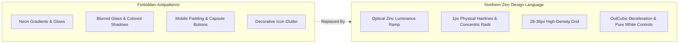

# Northern Zinc Design Language

This specification defines **Northern Zinc**, the official UI design language, concentric geometry system, color tokens, motion grammar, and component architecture for the Northern desktop framework. It pairs quiet neutral workspace chrome with SwiftUI-inspired tactile craft, high information density, and crisp 1px physical hairlines.

---

## 1. Core Philosophy and Anti-Slop Invariants

Desktop applications run side-by-side in multi-hour technical workflows where visual noise causes fatigue. Chrome must stay calm while data, typography, and active state cues remain unambiguous.

### The Four Design Invariants

1. **Quiet Chrome, Content Foreground**: Window chrome, sidebars, toolbars, and disclosure containers remain strictly neutral in Optical Zinc gray ramps. Saturated color is reserved exclusively for user content, primary triggers, active state indicators, and semantic status.
2. **Zero Unmotivated Neon, Gradients, or Blur**: Forbid purple-to-cyan gradients (`#6366F1` to `#8B5CF6`), glowing neon borders, colored drop shadows, and glassmorphic blur cards. Depth is communicated strictly through stepped surface luminance and 1px neutral hairlines.
3. **Concentric Geometry & Compact Density**: Nesting radii follow concentric math ($R_{\text{inner}} = R_{\text{outer}} - \text{inset}$) on a 4px layout grid with 28–36px control heights. Standard push buttons use crisp rounded rectangles (`6px`–`9px`)—never oversized capsule pills.
4. **Desktop-Native Ergonomics & Restraint**: Full keyboard navigation, focus-visible Cobalt rings, instant pointer cursor dispatch, and semantic-only iconography (`Warning`, `Error`, toolbar icons) over decorative clutter.



---

## 2. Optical Zinc Surface Hierarchy

Depth relies on a 5-level neutral luminance ramp framed by 1px alpha-blended hairline borders (`BorderWidthHairline * dpiScale_`). In dark mode, higher elevation surfaces step subtly upward in lightness (`#09090B` → `#323238`); in light mode, clean crisp whites separate against soft neutral zinc backdrops.

### Dark Mode Surface Ramp

| Elevation Tier  | Token Name       | Hex Value | Hairline Border             | Usage Context                                                 |
| :-------------- | :--------------- | :-------- | :-------------------------- | :------------------------------------------------------------ |
| **0 - Canvas**  | `SurfaceCanvas`  | `#09090B` | None                        | Window backdrop, list/table wells, detail panes               |
| **1 - Base**    | `SurfaceBase`    | `#121215` | None                        | Menu bars, table headers, segmented tracks, alternate rows    |
| **2 - Surface** | `SurfaceDefault` | `#18181B` | `rgba(255, 255, 255, 0.08)` | Sidebars, titlebars, grouped accordion cards, inspectors      |
| **3 - Raised**  | `SurfaceRaised`  | `#27272A` | `rgba(255, 255, 255, 0.12)` | Secondary buttons, segmented thumbs, inset row hover pills    |
| **4 - Overlay** | `SurfaceOverlay` | `#323238` | `rgba(255, 255, 255, 0.16)` | Context menus, dropdown popups, modal dialogs, tooltips       |

### Light Mode Surface Ramp

| Elevation Tier  | Token Name       | Hex Value | Hairline Border       | Usage Context                                    |
| :-------------- | :--------------- | :-------- | :-------------------- | :----------------------------------------------- |
| **0 - Canvas**  | `SurfaceCanvas`  | `#F4F4F5` | None                  | Desktop workspace backdrop, list/table wells     |
| **1 - Base**    | `SurfaceBase`    | `#FAFAFA` | None                  | Menu bars, table headers, segmented tracks       |
| **2 - Surface** | `SurfaceDefault` | `#FFFFFF` | `rgba(0, 0, 0, 0.08)` | Sidebars, titlebars, grouped cards, text inputs  |
| **3 - Raised**  | `SurfaceRaised`  | `#F4F4F5` | `rgba(0, 0, 0, 0.12)` | Secondary buttons, segmented thumbs, hover pills |
| **4 - Overlay** | `SurfaceOverlay` | `#FFFFFF` | `rgba(0, 0, 0, 0.14)` | Menus, dropdown popups, modal dialogs, tooltips  |

---

## 3. Accent System, Semantics, and Text Hierarchy

### Cobalt Accent Tokens

- **Accent Default**: `#2563EB` (`AccentDefault`) — primary buttons, focus rings, active slider tracks, selected checkmarks, expanded chevrons, active header dividers.
- **Accent Hover**: `#1D4ED8` (`AccentHover`) — primary button & checked switch hover.
- **Accent Active**: `#1E40AF` (`AccentActive`) — primary button pressed state.
- **Accent Muted**: `rgba(37, 99, 235, 0.20)` dark / `rgba(37, 99, 235, 0.15)` light (`AccentMuted`) — text selection, selected list rows (`0.17f`–`0.24f` fill with `TextPrimary`).
- **Focus Ring**: `rgba(37, 99, 235, 0.70)` (`AccentFocusRing`) — 2px outer focus border at 2px outset.

### Semantic Status Tokens

| Role               | Dark Mode Hex | Light Mode Hex | Usage Context                                      |
| :----------------- | :------------ | :------------- | :------------------------------------------------- |
| **Success**        | `#22C55E`     | `#16A34A`      | Validated checks, active status switches/sliders   |
| **Warning**        | `#F59E0B`     | `#D97706`      | Caution alerts (`MessageBox::warning`)             |
| **Danger / Error** | `#EF4444`     | `#DC2626`      | Destructive menu/button actions, error modals      |
| **Info**           | `#3B82F6`     | `#2563EB`      | Informational progress fills and accent indicators |

### Text Color Hierarchy

| Token Name      | Dark Mode Hex | Light Mode Hex | Usage Context                                      |
| :-------------- | :------------ | :------------- | :------------------------------------------------- |
| `TextPrimary`   | `#FAFAFA`     | `#09090B`      | Primary labels, titles, active menu/row items      |
| `TextSecondary` | `#A1A1AA`     | `#52525B`      | Descriptions, unselected tabs, row subtitles       |
| `TextTertiary`  | `#71717A`     | `#71717A`      | Placeholders, menu shortcut badges, disabled hints |
| `TextDisabled`  | `#52525B`     | `#A1A1AA`      | Disabled control labels and inactive foregrounds   |

---

## 4. Typography and Optical Centering

### Platform Font Stacks

- **Windows**: `Segoe UI Variable Text` / `Segoe UI`, Bold `Segoe UI Bold` (fallback `Arial`).
- **macOS**: `SF Pro Text` / system sans-serif.
- **Linux**: `Inter`, `Cantarell`, `Ubuntu`, or `Noto Sans`.
- **Monospace**: `Cascadia Code`, `Consolas`, `JetBrains Mono`, `Fira Code`.

### Type Scale Matrix (`theme::resolveFont`)

| Token                        | Size (px)       | Resolved Font          | Line Height Guidance | Target Usage                                           |
| :--------------------------- | :-------------- | :--------------------- | :------------------- | :----------------------------------------------------- |
| `TypographyStyle::Display`   | `24px * dpi`    | `semiBoldFont` (600)   | `~1.20x`             | Hero headlines, empty-state headers, splash banners    |
| `TypographyStyle::Title`     | `18px * dpi`    | `semiBoldFont` (600)   | `~1.25x`             | Window headers, detail pane headings, top view titles  |
| `TypographyStyle::Subtitle`  | `15px * dpi`    | `mediumFont` (500)     | `~1.30x`             | Secondary section headers, form group intros           |
| `TypographyStyle::BodyStrong`| `14px * dpi`    | `semiBoldFont` (600)   | `~1.38x`             | Dialog titles, card titles, sidebar headings, key KPIs |
| `TypographyStyle::Body`      | `14px * dpi`    | `defaultFont` (400)    | `~1.42x`             | Multi-line prose, descriptions, table cells, controls  |
| `TypographyStyle::Monospace` | `13px * dpi`    | `monospaceFont`        | `~1.40x`             | Technical readouts, memory/version badges, code, logs  |
| `TypographyStyle::Caption`   | `12px * dpi`    | `defaultFont` (400)    | `~1.36x`             | Helper hints, status subtitles, badges, click counters |
| **Dense Controls & Rows**    | `12–14.5px * dpi` | Regular / Medium   | Single-line centered | `Button`/`TextInput` (`12.5–14.5px`), `ContextMenu`/`Dropdown`/`Accordion` (`12–14.5px`), `ListView`/`TableView` (`13.5px`) |

### Hierarchy, Weight, and Contrast Rules

Informed by Microsoft Fluent 2 and Apple macOS Human Interface Guidelines for high-density desktop tools:

1. **Header Sizing Strategy**:
   - Step view anchors cleanly down from **pane/view titles (`Title` `18pt`)** to **subsection headers (`Subtitle` `15pt`)** or **compact group titles (`BodyStrong` `14pt`)** and **body copy (`Body` `14pt`)**.
   - Reserve **`Display` (`24pt`)** for uncrowded hero/empty states; avoid exceeding `18pt` inside dense sidebars or inspectors.
2. **When to Use Bold (`boldFont`)**:
   - **Structural Anchors**: Use `Title` (`18pt`) for view headers and `BodyStrong` (`14pt`) for card titles, modal headers, sidebar titles, and emphasized list headings.
   - **Avoid Over-Weighting ("Christmas Tree Effect")**: Never set paragraphs, descriptions, form values, or long wrapped prose in `BodyStrong`; heavier strokes close small glyph counters (`12–14pt`) and fatigue sustained reading. Prefer at most 1–2 bold anchors per card or panel.
3. **When to Use Regular + Color Luminance (`TextPrimary` / `TextSecondary` / `TextTertiary`)**:
   - Pair `Subtitle` (`15pt` Regular) with `TextPrimary`, descriptions (`Body` `14pt`) with `TextSecondary`, and timestamps/hints (`Caption` `12pt`) with `TextSecondary` or `TextTertiary`. Combining subtle scale shifts with optical luminance separates levels cleanly without extra heavy fonts.
   - Strictly forbid `Thin` / `Light` (`100–300`) weights in dense UI due to subpixel contrast loss.
4. **When to Use `Monospace` (`13pt`)**:
   - Use for numeric readouts, version strings, byte counts, coordinates, keyboard accelerators, and code snippets where tabular alignment aids scannability.
5. **Line Height & Optical Centering**:
   - Multi-line wrapped paragraphs use tighter heading line height (`~1.2x`) and looser body/caption leading (`~1.4x–1.5x` via `setLineHeightMultiplier()`).
   - Single-line labels inside fixed-height rows (`height = percent(100.0f)`) **must** position text with `theme::computeCenteredTextY(centerY, font)` (engaged automatically by `Label` when `VerticalAlignment::Center`), aligning cap-height center rather than raw ascender+descender bounds.

### Concrete Typography Example

```cpp
// Header + body + metadata + technical readout inside a detail panel:
auto viewHeader = std::make_unique<Label>(
    "Render Pipeline", theme::TypographyStyle::Title, theme::TextRole::Primary);

auto sectionLead = std::make_unique<Label>(
    "Physical Hairline & Retention Metrics", theme::TypographyStyle::Subtitle,
    theme::TextRole::Primary);

auto description = std::make_unique<Label>(
    "Retained display lists cull off-screen subtrees and skip redundant layout passes.",
    theme::TypographyStyle::Body, theme::TextRole::Secondary);

auto cardTitle = std::make_unique<Label>(
    "Frame Budget", theme::TypographyStyle::BodyStrong, theme::TextRole::Primary);

auto metricReadout = std::make_unique<Label>(
    "Vulkan 1.3+ / 64 KB Scratch", theme::TypographyStyle::Monospace,
    theme::TextRole::Secondary);

auto footnote = std::make_unique<Label>(
    "Updated on resize and DPI change", theme::TypographyStyle::Caption,
    theme::TextRole::Tertiary);
```

---

## 5. Concentric Geometry and Density Tiers

Northern Zinc anchors on a 4px spatial grid (`Metrics::GridBase = 4.0f`) scaled cleanly by `dpiScale_`.

### Concentric Corner Formula

Inner interactive highlights inside padded cards or tracks follow $R_{\text{inner}} = \max(4\text{px}, R_{\text{outer}} - \text{inset})$ so nested silhouettes share a visual center:

| Parent Surface / Container                    | Outer Radius | Inset          | Inner Element & Radius                         |
| :-------------------------------------------- | :----------- | :------------- | :--------------------------------------------- |
| `ContextMenu` (`SurfaceOverlay`)              | `10px`       | `4px H / 2px V` | Menu item highlight pill (`6px`)               |
| `DropdownPopup` (`SurfaceOverlay`)            | `10px`       | `4px H / 1px V` | Option highlight pill (`6px`)                  |
| `Accordion` header/body (`Grouped` card)      | `10px`       | `4px`          | Header inset hover/focus pill (`6px`)          |
| `TabBarStyle::Segmented` track (`SurfaceBase`) | `8px`       | `2px`          | Sliding active `SurfaceRaised` thumb (`6px`)   |
| Standard Push Controls (`Button`, `TextInput`) | `6px`/`8px`/`9px` | —         | 2px outset focus ring (`R + 2px`)              |

### Density Tiers

| Metric                         | Compact (`28px`) | Standard (`32px`) | Comfortable (`36px`) |
| :----------------------------- | :--------------- | :---------------- | :------------------- |
| **Control Height**             | `28px`           | `32px`            | `36px`               |
| **Button Corner Radius**       | `6px`            | `8px`             | `9px`                |
| **TextInput / Control Radius** | `4px`–`6px`      | `6px`             | `6px`                |
| **Horizontal Padding**         | `8px`            | `12px` (`10px` input) | `16px`           |

---

## 6. Window Chrome and Navigation

1. **TitleBar (`TitleBar`)**: `36px`–`40px` height on `SurfaceDefault` with `1px` subtle bottom divider, native SVG caption controls (`46px` wide targets, `#E81123` close hover), center slot, and DWM `WM_NCHITTEST` drag/snap regions.
2. **MenuBar (`MenuBar`)**: `SurfaceBase` strip with `1px * dpiScale_` `BorderSubtle` bottom separator, `CornerRadiusControl` (`6px`) `SurfaceRaised` pills (`0.55` hover / `0.85` open fading across `0.12s OutCubic`), keyboard focus rings, and disabled state guards.
3. **TabBar (`TabView` / `TabBar`)**:
   - `Underline`: quiet horizontal tab strip with an animated `0.15s OutCubic` accent bottom bar (`2px * dpiScale_`).
   - `Pill` & `EditorCard`: rounded pills (`CornerRadiusControl`) or document editor tabs with optional close buttons, per-tab `0.55f` `SurfaceRaised` hover fades (`0.12s OutCubic`), and drag-to-reorder.
   - `Segmented`: SwiftUI `.pickerStyle(.segmented)` track (`SurfaceBase`, `8px` radius) with vertical inactive hairlines and a sliding `SurfaceRaised` + `BorderDefault` thumb (`6px` radius).
   - Shared invariants: full `dpiScale_` metric/stroke scaling, disabled-state input/visual guards, nearest-enabled-tab fallback on removal or disable, and style-matched `Widget::paintFocusRing()` (`CornerRadiusControl * scale` for `Pill`/`Segmented`, `0px` for `Underline`/`EditorCard`).
4. **SplitView (`SplitView`)**: Defaults to `SplitStyle::Hairline` (`1px * dpiScale_` divider with an invisible `4px * dpiScale_` `grabMargin_` and hover/drag/focus-revealed rounded pill grip), `FixedFirst`/`FixedSecond`/`Proportional` pane sizing, and `0.22s InOutCubic` collapsible transitions.

---

## 7. Component Specifications

### 1. Button

- **Geometry & Variants**: `Primary` (Cobalt fill, white text), `Secondary` (`SurfaceRaised` fill, `BorderSubtle`), `Outline` (transparent, `BorderDefault`), `Ghost` (transparent, `TextSecondary`), `Destructive` (`Danger` fill).
- **Motion & Lifecycle**: `0.12s OutCubic` fill/border color fades paired with `SpringConfig::Snappy` (`1.0 → 0.97`) press scale around the button center, mouse grab during active press, automatic `contextDpiScale()` and `onThemeChanged()` token sync, and clean press/hover/cursor reset on disable or loading.

### 2. TextInput

- **Geometry & Features**: `Compact` (`28px`), `Standard` (`32px`), `Comfortable` (`36px`), `6px` radius, `1.5px` blinking caret, `3px` rounded selection highlights (`AccentMuted`), optional leading SVG icon (`IconId::Search`), and trailing circular clear pill.
- **Synchronized Focus Motion**: `hoverAnim_` (`0.12s OutCubic`) and `focusAnim_` (`0.14s OutCubic`) interpolate the border continuously (`BorderDefault` → `BorderStrong` → `AccentDefault`) while fading `AccentFocusRing` in sync.

### 3. Switch, Checkbox, and RadioButton

- **Switch (Toggle)**: Borderless soft capsule track (`SurfaceOverlay` dark / `BorderDefault` light when off; semantic role when on) with a pure white circular thumb (`#FFFFFF` in both checked and unchecked states), `0.08s` pill press stretch, and a crisp `0.16s OutCubic` thumb slide.
- **Checkbox & RadioButton**: `16px * dpi` targets with animated vector stroke checkmarks/dots (`checkAnim_`), Cobalt accent checked fills, subtle unchecked press tint, `10.5pt * dpi` default font fallback, and mouse-grab release safety.

### 4. Slider and ProgressBar

- **Slider**: `4px` rounded track (`SurfaceRaised` / `BorderDefault` inactive, role color active), pure white circular knob (`#FFFFFF`) with a crisp `1.0px * dpiScale_` `BorderDefault` hairline (`activeTrackColor` only while dragging or focused), and `0.12s OutCubic` `1.0 → 1.15` hover scaling.
- **ProgressBar**: Smooth determinate fill transitions (`0.20s OutCubic`) and eased indeterminate marquee pulse with optional right-aligned percentage readout.

### 5. ContextMenu and Dropdown

- **Shared Card Architecture**: Floating `SurfaceOverlay` cards (`10px` radius, `1px BorderSubtle`) opening cleanly without height clipping, displaying concentric `4px`-inset (`6px` radius) `SurfaceRaised` pills (`0.55` hover fade over `0.12s OutCubic`, `0.85` press matching `Accordion`; `danger` tint on destructive hover), inset hairline dividers (suppressed adjacent to highlighted rows), subtle centered `BorderDefault` `addSeparator()` hairlines, and trailing SVG icons.
- **Dropdown**: Trigger displays an animated rotating chevron (`0.18s OutCubic`) tinting toward `AccentDefault` on hover/open; popup (`DropdownPopup`) mirrors `ContextMenu` `10px` cards, `4px`-inset (`6px` radius) `0.55` hover / `0.85` press pills (`0.12s OutCubic`), and Cobalt selection checkmarks.

### 6. Accordion and DisclosureGroup

- **Grouping Styles**: `AccordionStyle::Grouped` (default) renders a unified `SurfaceDefault` rounded card (`10px` radius, `1px BorderSubtle`) with `16px` horizontal inset section hairlines; `AccordionStyle::Separated` renders individual `SurfaceDefault` cards with an `8px` gap; `AccordionStyle::Flush` renders borderless inspector sections with full-width `1px BorderSubtle` dividers.
- **Interactive Header**: `38px` Standard (`11.5pt`) / `30px` Compact (`10.5pt`) rows with concentric `4px`-inset (`6px` radius) hover pills (`0.12s OutCubic`) and matching Cobalt focus rings (`Widget::paintFocusRing`), trailing rotating Cobalt chevrons (`0.25s InOutCubic`), `addRow()` optical text rows (`20px` left indentation), and smooth animated height collapse.

### 7. Collection Views (`ListView`, `TableView`, `TreeView`, `HeaderView`)

- **`ListView`**: Supports `ListStyle::Inset` (default: bordered `SurfaceCanvas`, `6px` rounded inset hover/selection pills with Cobalt `0.17f`–`0.24f` selection tint, inset row hairlines, no zebra stripes), `ListStyle::Sidebar` (transparent borderless pills sitting directly over `SplitView` `SurfaceDefault` sidebars), and `ListStyle::Plain`.
- **`TableView` & `TreeView`**: Integrated `HeaderView` with Cobalt-highlighted active resize dividers (`2px`), optional outer border toggles (`setShowBorder`), theme-adaptive Dark/Light scrollbars, and live `ColorPalette` injection into `ItemDelegate`.

### 8. ScrollView and Quiet Overlay Scrollbars

- **Visibility Policy**: `ScrollbarVisibility::Automatic` (default) displays slim overlay thumbs on open, scroll, hover, or drag, then fades out smoothly (`0.18s OutCubic`) after `800ms` of inactivity (`kInactivityFadeDelay`). `AlwaysVisible` and `Never` overrides are supported.
- **Hover Expansion & Grab**: Thumbs expand smoothly from `0.67x` rest width to `1.0x` on hover/drag (`0.12s OutCubic`) and acquire pointer mouse grab during dragging.

### 9. Modal Dialogs and MessageBox

- **Presentation**: Centered `SurfaceOverlay` card (`10px` radius, `BorderDefault`) over a `0.14s OutCubic` animated `0.55` backdrop scrim, trapping `Tab`/`Shift+Tab` focus and mapping `Enter` / `Escape` cleanly.
- **Icon Restraint**: `MessageBox::info` and `MessageBox::confirm` omit icons cleanly; `MessageBox::warning` and `MessageBox::error` display semantic `24px` badges.

---

## 8. Keyboard Ergonomics and Motion Grammar

Desktop software requires distinct timing semantics depending on whether an element communicates direct pointer state, structural layout change, or tactile press energy:

| Animation Role              | Curve & Timing             | Rationale                                                      |
| :-------------------------- | :------------------------- | :------------------------------------------------------------- |
| **Hover / Focus / Menu Pill** | `OutCubic` (`120–140ms`) | Instant visual lock with zero asymptotic tail or sluggish lag  |
| **Toggle / Slider / Scrollbar** | `OutCubic` (`120–180ms`) | Clean, straight travel without overshoot outside track bounds |
| **Collapse / Resize Motion** | `InOutCubic` (`220–250ms`) | Balanced acceleration/deceleration for `Accordion` & `SplitView` |
| **Tactile Press Feedback**  | `SpringConfig::Snappy`     | Brief `1.0 → 0.97` elastic squish on `Button` press            |

- **Focus-Visible Contract**: `Button`, `Checkbox`, `Switch`, `RadioButton`, `Slider`, `Dropdown`, `Accordion`, `SplitView`, and `TabBar` paint Cobalt focus rings **only** for `FocusReason::Keyboard`. `TextInput` always illuminates its border + focus ring when focused.

---

## 9. C++ Implementation Tokens Reference

All visual tokens resolve dynamically through `ColorPalette::dark()`, `ColorPalette::light()`, and `Metrics` in [theme.hpp](../src/widgets/base/theme.hpp):

```cpp
namespace northern::theme {

struct ColorTokens {
    // Dark Mode Optical Zinc Ramp
    static constexpr core::Color SurfaceCanvas{0.035f, 0.035f, 0.043f, 1.0f};  // #09090B
    static constexpr core::Color SurfaceBase{0.071f, 0.071f, 0.082f, 1.0f};    // #121215
    static constexpr core::Color SurfaceDefault{0.094f, 0.094f, 0.106f, 1.0f}; // #18181B
    static constexpr core::Color SurfaceRaised{0.153f, 0.153f, 0.165f, 1.0f};  // #27272A
    static constexpr core::Color SurfaceOverlay{0.196f, 0.196f, 0.220f, 1.0f}; // #323238

    // Hairline Borders
    static constexpr core::Color BorderSubtle{1.0f, 1.0f, 1.0f, 0.08f};
    static constexpr core::Color BorderDefault{1.0f, 1.0f, 1.0f, 0.12f};
    static constexpr core::Color BorderStrong{1.0f, 1.0f, 1.0f, 0.16f};

    // Accent System (Cobalt #2563EB)
    static constexpr core::Color AccentDefault{0.145f, 0.388f, 0.922f, 1.0f}; // #2563EB
    static constexpr core::Color AccentHover{0.114f, 0.306f, 0.847f, 1.0f};   // #1D4ED8
    static constexpr core::Color AccentActive{0.118f, 0.251f, 0.686f, 1.0f};  // #1E40AF
    static constexpr core::Color AccentMuted{0.145f, 0.388f, 0.922f, 0.20f};
    static constexpr core::Color AccentFocusRing{0.145f, 0.388f, 0.922f, 0.70f};
};

struct Metrics {
    static constexpr float GridBase = 4.0f;
    static constexpr float ControlHeightCompact = 28.0f;
    static constexpr float ControlHeightStandard = 32.0f;
    static constexpr float ControlHeightComfortable = 36.0f;
    static constexpr float CornerRadiusControl = 6.0f;
    static constexpr float CornerRadiusButtonCompact = 6.0f;
    static constexpr float CornerRadiusButtonStandard = 8.0f;
    static constexpr float CornerRadiusButtonComfortable = 9.0f;
    static constexpr float CornerRadiusCard = 8.0f;
    static constexpr float CornerRadiusOverlay = 10.0f;
    static constexpr float BorderWidthHairline = 1.0f;
    static constexpr float FocusRingWidth = 2.0f;
    static constexpr float FocusRingOffset = 2.0f;
};

} // namespace northern::theme
```
